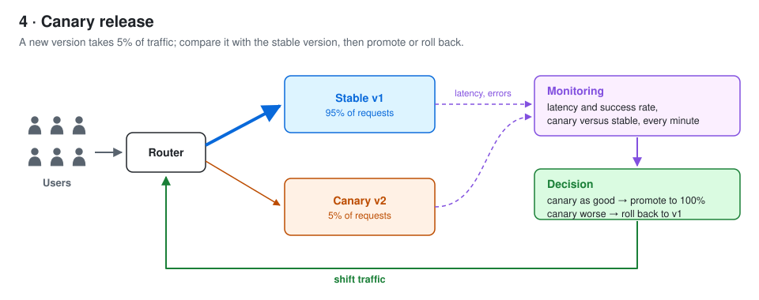

# Canary Release

A canary release sends a small share of traffic to a new version and compares it with the running version.
A rule reads query results at every check and decides to roll back or to promote.
This page lists what public tools query and decide, and the end-to-end cases we benchmark.
Sources: Flagger, Argo Rollouts, AWS CloudWatch, Keptn, Kayenta (Spinnaker), Netflix (KDD 2022), Google SRE Workbook.



## 1. Industry examples

| Source | Metrics | Query | Compared against | Decision |
| --- | --- | --- | --- | --- |
| [Flagger](https://docs.flagger.app/usage/metrics) | Request success rate (non-5xx), request duration p99 | Built-in checks, or a PromQL template such as `histogram_quantile(0.99, sum(rate(response_latency_ms_bucket{...}[1m])) by (le))` | Fixed threshold: success rate ≥ 99%, p99 ≤ 500 ms | A failed check adds 1 to a counter; rollback when it reaches `threshold`. A passing check adds `stepWeight` of traffic; promote at `maxWeight`. The counter resets only when a new revision starts ([scheduler.go](https://github.com/fluxcd/flagger/blob/main/pkg/controller/scheduler.go)). |
| [Argo Rollouts](https://argo-rollouts.readthedocs.io/en/stable/features/analysis/) | Any provider query; the example is success rate | `sum(irate(istio_requests_total{response_code!~"5.*"}[5m])) / sum(irate(istio_requests_total[5m]))` | Fixed condition, e.g. `result[0] >= 0.95` | Measure every `interval`, `count` times. Fail when failed measurements exceed `failureLimit` (total, not consecutive). Success needs `consecutiveSuccessLimit` passes in a row. |
| [AWS CloudWatch](https://docs.aws.amazon.com/AmazonCloudWatch/latest/monitoring/alarm-evaluation.html) ([CodeDeploy](https://docs.aws.amazon.com/codedeploy/latest/userguide/deployments-rollback-and-redeploy.html) rolls back on the alarm) | Any metric statistic per period | One statistic per period | Fixed threshold | "M out of N": alarm when M of the last N data points breach; they need not be consecutive; the window slides. |
| [Keptn](https://github.com/keptn/spec/blob/master/service_level_objective.md) | Service-level indicators, e.g. response time p95 | One value per evaluation | Previous results (average of the last 3 that passed), and a fixed value | Per objective: e.g. `<=+10%` relative and `<600` absolute. Weighted total score: pass ≥ 90%, warning ≥ 75%. |
| [Kayenta (Spinnaker)](https://spinnaker.io/docs/guides/user/canary/judge/) | A set of metrics in weighted groups | The time series of each metric, for canary and baseline | Baseline | Mann-Whitney U test per metric at 98% confidence: Pass, High or Low. Group score = share of metrics that pass; summary = weighted average. Pass and marginal thresholds. |
| [Netflix (KDD 2022)](https://arxiv.org/abs/2205.14762) | Not stated in the abstract | Distribution of each version | Baseline | Sequential tests of stochastic order and of equality in distribution, monitored continuously with false detection controlled throughout. |
| [Google SRE Workbook](https://sre.google/workbook/canarying-releases/) | HTTP return codes and latency; not CPU; at most about a dozen | Per population (canary, control) | Control at the same time, not before and after; plus absolute SLO checks | Qualitative: similar error ratios → proceed; otherwise pause, roll back or escalate. |

## 2. Query candidates

| ID | Query | From | ASAPPlanner (b822553) |
| --- | --- | --- | --- |
| Q1 | Canary latency p99: `quantile_over_time(0.99, request_latency{version="canary"}[5m])` | Flagger, CloudWatch | Runs; without raw data at error target 0.01 the plan uses KLL |
| Q2 | Canary p99 / stable p99: Q1 `/ ignoring(version)` the same for stable | Google (control at the same time), current workload | Runs; without raw data the plan uses DDSketch |
| Q3 | `histogram_quantile(0.99, sum by (le) (rate(request_latency_bucket{version="canary"}[5m])))` | Flagger template | Runs; no sketch in the plan, even without raw data |
| Q4 | Latency p95 per evaluation: Q1 with 0.95; an earlier window with `offset 1h` | Keptn | Both run; without raw data the plan uses KLL |
| Q5 | Error rate: `sum(rate(requests_total{code=~"5.."}[5m])) / sum(rate(requests_total[5m]))` | Flagger, Argo Rollouts, Google | Runs; no sketch in the plan, even without raw data |
| Q6 | Latency distribution of each version | Kayenta, Netflix | No PromQL function returns a distribution; not expressible today |

Checked by running each query through `planeval` on a small synthetic spec, exact and at error target 0.01 without raw data.

The workload (`aqpbm-planeval/workloads/uc4_canary.json`) runs three queries: Q1 for canary (`p99_canary`) and for stable (`p99_stable`), with the ratio taken by the rule; and Q5 as a success rate, `sum(count_over_time(requests{version="canary", code="200"}[5m])) / sum(count_over_time(requests{version="canary"}[5m]))` (`success_rate_canary`), because the generator writes one sample per request, not a counter. Q2, Q3, Q4 and Q6 are not in the workload.

## 3. Data shape

One wide table, one row per request. Real setups query several columns of the same requests at once (Flagger checks success rate and p99 latency together).

| Column | Values | Distribution | Source |
| --- | --- | --- | --- |
| time | Timestamp | Stable: one request every 5 ms. Canary: one every 95 ms, so about 5% of requests. | Current workload; 5% canary population (Google SRE Workbook) |
| version | `stable`, `canary` | Follows from the time column. | Current workload |
| status_code | `200`, `500` | Both versions: 0.1% of requests return 500 (no public number; ours). Canary in a bad release, minutes 120 to 150: 20% return 500. | Google SRE Workbook |
| latency | Seconds | Both versions: Pareto, alpha 3, scale 0.05 s. A slow canary is one of: <br>× 1.08 in minutes 30 to 60 and × 1.25 in minutes 70 to 110, each ramping in over 10 minutes (current workload, ours); <br>minutes 160 to 190: 5% of requests take at least 2 s, Pareto alpha 3 scale 2 s (Google SRE Workbook); <br>minutes 200 to 230: 8.7% of requests take 1 s, standing in for extra 1 s requests on top of normal load ([Flagger tutorial](https://docs.flagger.app/tutorials/istio-progressive-delivery)). | As listed |
| latency bucket counts | Counters per bucket bound `le` | Derived from latency: requests with latency ≤ each bound. Bounds not chosen yet. | Only for Q3 (Flagger template); not generated |

The workload runs 250 minutes and has time, version, status_code and latency; the bucket counts are not generated.

## 4. Decision rules

A rule has two parts: what it concludes from each query result, and how it aggregates many query results into rollback or promote. Numbers are the values in each source's own example.

On each query result:

- Flagger: the check fails when canary success rate < 99% or canary p99 > 500 ms.
- Argo Rollouts: the measurement fails when success rate < 0.95.
- CloudWatch: the data point breaches when it is above the alarm threshold. The user sets the threshold; there is no default. We use Flagger's 500 ms.
- Keptn: the objective passes when p95 is at most 10% above the average of the last 3 passing evaluations and below 600 ms.
- Kayenta: a Mann-Whitney U test compares canary and baseline samples at 98% confidence. The metric is High or Low only when the confidence interval falls outside ±25% of the estimated shift and the effect size passes its threshold; otherwise it passes.
- Netflix: a sequential test compares the canary and baseline distributions and flags a regression as soon as it rejects equality.
- Ours (current): the check is slower when canary p99 > 1.1 × stable p99.

Aggregation over multiple query results:

- Flagger: roll back after 10 failed checks in total (`threshold: 10`); a passing check does not reset the count. Each passing check raises canary traffic by 2% (`stepWeight`); promote at 50% (`maxWeight`), so after at least 25 passing checks. A rollout therefore spans at most 34 checks, which does not line up with the 30-minute scenarios.
- Argo Rollouts: measure every 5 minutes (`interval`), `count` times; fail, and roll back, when failures in total exceed 3 (`failureLimit`). Success needs `consecutiveSuccessLimit` passes in a row. We use `count: 10`.
- CloudWatch: alarm when 4 of the last 5 data points breach, consecutive or not; CodeDeploy then rolls back. We cut checks into rollouts of 10.
- Keptn: objectives are weighted into a total score; ≥ 90% passes, ≥ 75% warns, lower fails.
- Kayenta: a group's score is the share of its metrics that pass; the final score is the weighted average of groups. At or above the pass threshold passes, at or above the marginal threshold is marginal, lower fails. A critical metric that is High or Low sets the score to 0.
- Ours (current, no public source): checks are cut into blocks of 10; 3 slower checks in a row in a block rolls back, otherwise the block promotes.

Ours, not from a public source, to study how a rule can use the error bound:

- Each approximate result carries an interval from its error bound. The check is slower when the whole interval is above the tolerance, not slower when it is wholly below, and unsure otherwise.
- Same, but an unsure check reruns that one query with the exact plan.

## 5. End-to-end candidates

| ID | Query | On each result | Aggregation | From | Rule in `scripts/rollout.py` |
| --- | --- | --- | --- | --- | --- |
| E1 | p99 latency of canary and of stable over 5 minutes, every minute | Slower when canary p99 > 1.1 × stable p99 | Blocks of 10 checks; 3 slower in a row rolls back, otherwise promote | Current workload | `ours` |
| E2 | Canary p99 latency and canary success rate, every minute | Fails when p99 > 500 ms or success rate < 99% | Roll back at 10 failures in total; promote after 25 passes | Flagger | `flagger` |
| E3 | Canary success rate over 5 minutes, every 5 minutes | Fails when success rate < 0.95 | Roll back when failures exceed 3 of 10 | Argo Rollouts | `argo_rollouts` |
| E4 | Canary p99 latency, every minute | Breaches when p99 > 500 ms | Roll back when 4 of the last 5 breach | CloudWatch | `cloudwatch` |
| E5 | Canary p95 latency, once per evaluation | Fails when p95 is more than 10% above the average of the last 3 passing evaluations, or ≥ 600 ms | Score ≥ 90% passes, ≥ 75% warns | Keptn | Not yet |
| E6 | Latency samples of canary and of baseline | Mann-Whitney U test at 98% confidence | Score against the pass and marginal thresholds | Kayenta | Not yet |

## 6. Benchmark metrics

| Group | Measure | Status |
| --- | --- | --- |
| Query accuracy | Rank error of each p99 answer; relative error of each success rate | Measured |
| Decision | Agreement with the exact plan's decision; false and missed rollbacks; decision delay; per rule | Measured |
| Decision | Agreement with the injected scenario | Not yet |
| Cost | Query latency per evaluation, without plan compile time | Measured |
| Cost | View refresh time and insert throughput; the sketch insertion is replayed in one batch per window, not streamed | Measured |
| Cost | Bytes per evaluation: sketch state bytes plus raw sample bytes read at query (samples × 16 bytes) | Measured |
| Cost | Plan compile time; planning time | Measured |
| Cost | Process peak memory and CPU time | Not yet |

Every exact and approximate plan comes from ASAPPlanner and runs in `planeval`; the exact plan's scan reads every series of the metric and filters by `version` afterwards, so raw bytes read count both versions.

## 7. Reproduce

```bash
cargo build --release -p aqpbm-planeval
python3 scripts/run_use_case.py 4 --trials 3
python3 tools/grafana/generate_dashboards.py
tools/grafana/run.sh
```

`run_use_case.py` runs the exact plan once, then every arm three times, and writes rows to `target/grafana-data`. Dashboards: `http://localhost:3000/d/rollout` (one run, one rule), `/d/two-stages` and `/d/overview`.
